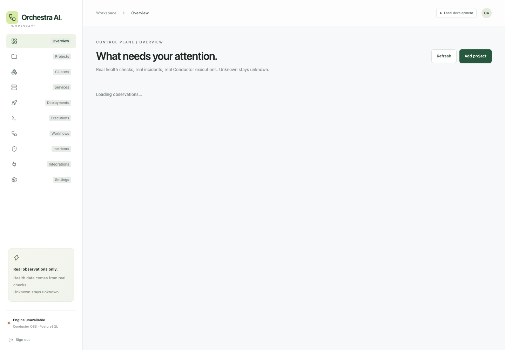
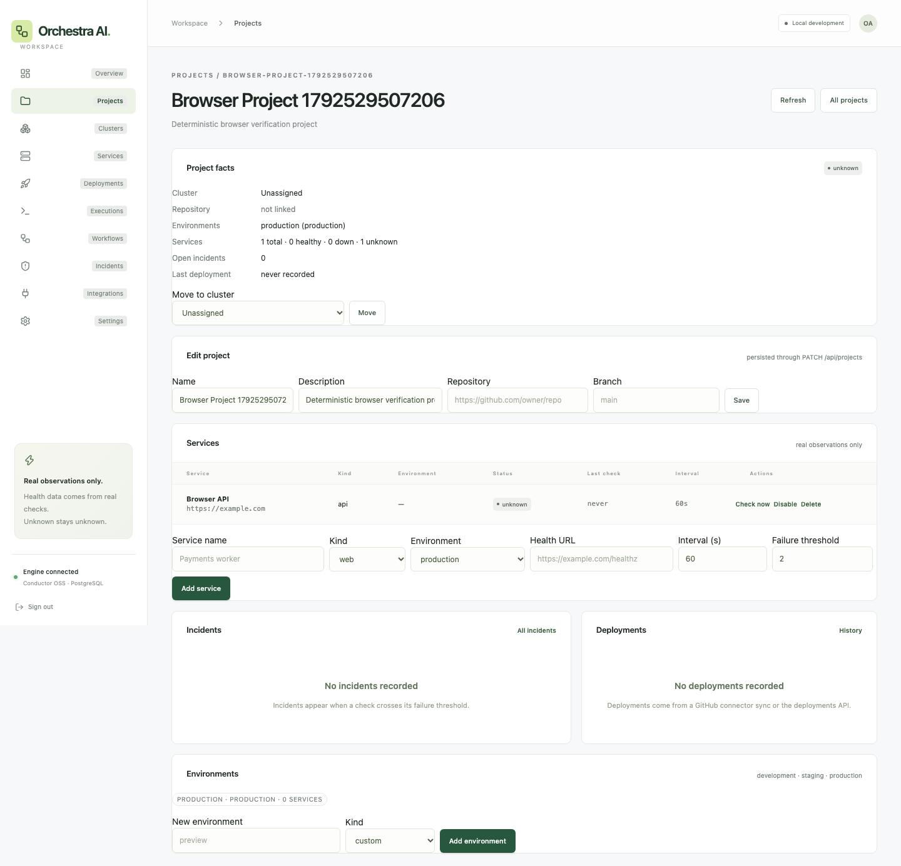
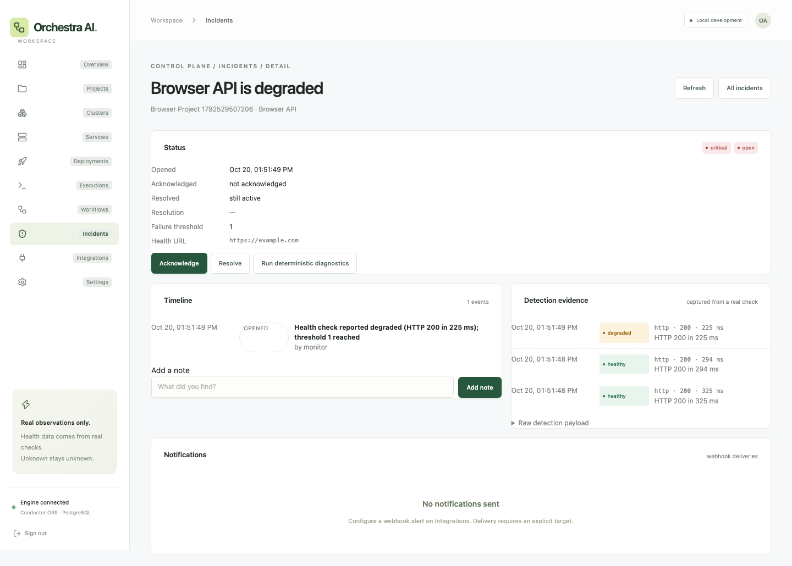
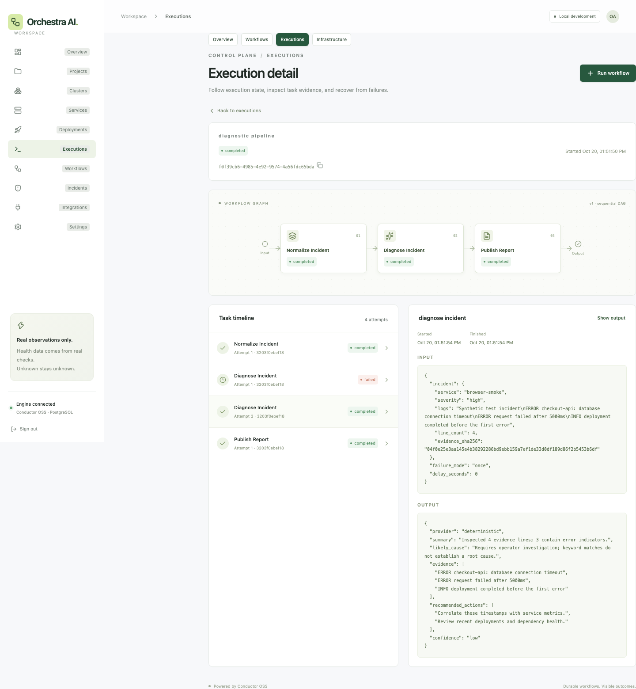
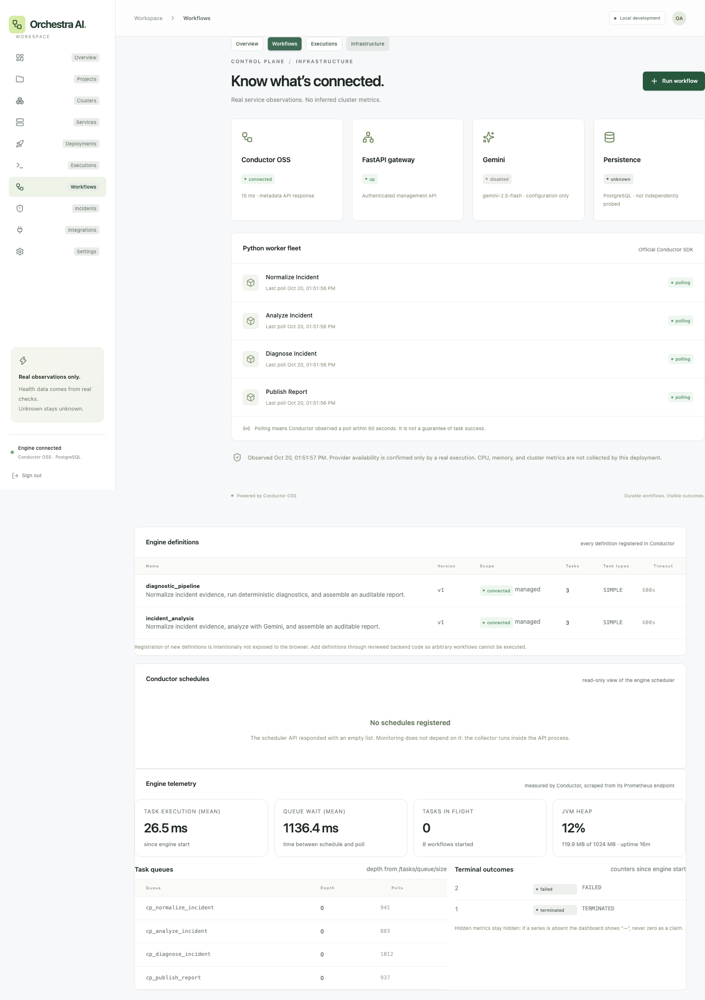

# Orchestra AI

A self-hostable **personal developer control plane** for the projects you build. Register projects, environments, services and clusters; watch real health checks and incidents; and operate durable Conductor workflows — all from one dashboard, for one owner.



Conductor OSS remains the only workflow engine. Orchestra AI adds an application-owned inventory, monitoring and incident layer around it; it never re-implements scheduling, retries or execution state.

## Orkes parity map

Orkes Conductor is the commercial product around an open-source engine. This project reproduces the parts one developer actually uses, and is explicit about what it does not:

| Orkes capability | Orchestra AI |
| --- | --- |
| Durable workflows on a documented production profile | Conductor OSS with the docs' **PostgreSQL stack**: Postgres for db/queue/payload/indexing, **Valkey for the execution lock**, sweeper and system-task tuning, explicit payload thresholds |
| Workflow and task inspection | Execution history, filtering, task timelines, failed-task evidence, retry/termination, definition catalog, read-only schedules |
| Engine observability | Real telemetry scraped from Conductor's Micrometer/Prometheus endpoint: queue depth, task execution and queue-wait time, terminal outcomes, JVM heap, uptime |
| Worker isolation per environment | Conductor **task domains** (`taskToDomain`) with the documented `NO_DOMAIN` fallback; `WORKER_DOMAIN` runs an isolated fleet |
| Applications, RBAC, multi-tenant control plane | **Not reproduced.** Single owner, one workspace, no SSO/billing — deliberately out of scope |
| Hosted platform | Self-hosted on one free VM (`docs/DEPLOY_FREE.md`), not a managed service |

## What works today

- **Project inventory**: projects → environments → services, plus logical clusters and deployments, persisted in an application-owned PostgreSQL database with migrations.
- **Real monitoring**: an in-process collector performs HTTP health checks on each service's own interval, records bounded observation history with source and timestamp, and applies failure/recovery thresholds. It keeps running with the dashboard closed.
- **Incidents**: automatic open/deduplicate/auto-resolve, acknowledgment, notes, manual resolution and evidence snapshots from the triggering check.
- **Alerts**: webhook delivery with severity filters, cooldowns and per-delivery records. Nothing is sent until you configure an explicit target.
- **Integrations**: Railway (GraphQL inventory), GitHub (repository, commits, workflow runs → deployments) and an agent-ingest path for local Docker. Credentials are sealed with AES-GCM and never returned to the browser.
- **Conductor operations**: execution history and filtering, task timelines, failed-task inspection, worker polling, manual retry/termination, definition browser, engine-wide definition catalog and a read-only schedule view.
- **Deterministic diagnostics**: start the existing `diagnostic_pipeline` from any incident; its evidence summary is passed as untrusted input.
- **Single-owner auth**: password or master API token exchanged for an opaque, HTTP-only, server-side session. Sessions are revocable; the master token never reaches the browser.
- **Honest telemetry**: unknown stays unknown. If a provider or a check cannot produce evidence, the service is not reported as down.

## Start locally

Requirements: Docker with Compose v2, ~4 GB free memory, and Python 3 for secret generation.

```sh
python3 scripts/setup_env.py      # writes a private .env with tokens and an owner password
docker compose up -d --build --wait --wait-timeout 240
```

Open **http://localhost:3000** and sign in with `OWNER_PASSWORD` (or `CONTROL_PLANE_TOKEN`) from `.env`.

Only the dashboard (`127.0.0.1:3000`) and the authenticated API (`127.0.0.1:8000`) are published. Conductor and PostgreSQL stay on the private Compose network; the application database is created automatically inside the same PostgreSQL instance but in its **own database**, separate from Conductor's schema.

## Register your first project

1. **Projects → Add project**: name, description, cluster, optional GitHub repository.
2. Choose environments (development / staging / production).
3. Add a service with a health endpoint. The first check runs immediately; subsequent checks follow the interval.
4. Open the project to inspect status, trigger a check, disable monitoring or move the project to another cluster.

A project without health URLs stays explicitly `unknown` — it is never guessed healthy.

## Engine profile and telemetry

`infra/conductor.properties` follows the Orkes *Production Deployment* guide for the "PostgreSQL stack (simplest)":

- PostgreSQL for database, queue, external payload storage and indexing.
- **Valkey** for `conductor.workflow-execution-lock` (BSD-licensed, no Redis licence concerns).
- Sweeper (`sweeperThreadCount=8`) and system-task workers (20 threads / 20 polls) tuned as documented.
- Explicit payload thresholds (5 MB spill, 10 MB hard limit for workflows; 3 MB / 10 MB for tasks).
- Micrometer metrics on `/actuator/prometheus`; the Elasticsearch health indicator is disabled because indexing is PostgreSQL-native.

The dashboard reads that endpoint plus `/api/tasks/queue/size` and shows queue depth, mean task execution, mean queue wait, terminal outcomes, heap usage and uptime. Missing series display as `—`, never as zero.

## Task domains

`TASK_DOMAIN=production` starts executions with `taskToDomain: {"*": "production, NO_DOMAIN"}`, which is the documented fallback: use a domain-specific worker fleet when one is polling, otherwise fall back to the default queue. Run a second fleet with `WORKER_DOMAIN=production` to isolate it. With no domain configured, behaviour is unchanged.

## Monitoring behaviour

- Checks are `GET` requests with a per-service timeout; redirects are **not** followed.
- SSRF protection rejects loopback, private, link-local and unresolvable targets, credential-bearing URLs and plain HTTP unless `HTTP_CHECK_ALLOW_PRIVATE=true` is set deliberately for local development.
- A check that cannot be performed (blocked target, DNS failure) is recorded as `unknown` and never creates an incident.
- A real failure becomes `down` (or `degraded` for an unexpected 2xx) only after `failure_threshold` consecutive failures. Recovery needs `recovery_threshold` successes.
- One active incident per service; recovery resolves it automatically with an event trail.
- Observations are pruned by age (`MONITOR_RETENTION_DAYS`) and per-service count, plus expired sessions.
- A PostgreSQL advisory lock guarantees only one collector ticks at a time, even with multiple API replicas.

## Conductor workflows

| Workflow | Tasks | External API |
|---|---|---|
| `diagnostic_pipeline` v1 | Normalize → deterministic diagnostics → report | None |
| `incident_analysis` v1 | Normalize → Gemini analysis → report | Google Gemini |

Task retries are capped at two for deterministic workers (3 s delay, 75 s response timeout, 90 s task timeout, 600 s workflow timeout). Gemini has **zero automatic retries** and a single HTTP attempt so an ambiguous failure never becomes a second billable call.

Definitions are registered by the API at startup. Arbitrary user-supplied definitions are deliberately **not** accepted from the browser: adding one requires reviewed backend code.

## Integrations

| Provider | What it does | Status |
|---|---|---|
| Railway | Reads project/service/environment inventory with a project or account token (`backboard.railway.app/graphql/v2`) | Implemented; the inventory query is unverified without a real token, and Railway exposes no per-service health through it |
| GitHub | Repository metadata, recent commits and workflow runs become deployment events | Implemented with optional token (public repos work anonymously) |
| Docker agent | `scripts/docker_agent.py` reads `docker ps` locally and pushes observations with a connector token | Implemented; the platform never reaches into your machine |
| HTTP | Native HTTP checks for any service | Implemented |
| Render / Vercel / Kubernetes | Adapter interface only | Not implemented — no pretend integrations |

Credentials are encrypted with a key derived from `SECRET_KEY` (or the control-plane token if unset). Rotating that key invalidates stored connector credentials; re-enter them afterwards.

## Verification

```sh
make test-db      # complete backend suite inside the Compose network (26 tests)
make typecheck
make build
make browser      # 3 Playwright tests against the live stack
make smoke        # real Conductor executions, retries, termination
```

`make test` runs the same suite on the host; database-backed tests then report as **skipped** with an explicit reason instead of silently passing.

The backend suite includes an end-to-end cycle on deterministic local infrastructure: register project → register service → observe healthy → simulate a failing check → incident created → inspect evidence → restore health → automatic recovery and resolution. It also covers SSRF rejection, secret sealing, credential redaction, alert deduplication and cooldowns, connector token rotation and agent authentication.

`scripts/recovery.py` is destructive and local-Compose-only. Never run it against Railway or any shared stack.

## Configuration

| Variable | Purpose |
|---|---|
| `CONTROL_PLANE_TOKEN` | Master API token for scripts/CI (never sent to the browser) |
| `OWNER_PASSWORD` | Dashboard password; empty disables password login |
| `SECRET_KEY` | Encrypts connector credentials at rest |
| `POSTGRES_PASSWORD` | PostgreSQL password (shared with Conductor in Compose) |
| `DATABASE_NAME` / `DATABASE_URL` | Application database (default `orchestra`) |
| `MONITOR_ENABLED`, `MONITOR_TICK_SECONDS`, `MONITOR_RETENTION_DAYS` | Collector behaviour |
| `HTTP_CHECK_ALLOW_PRIVATE` | Allow private targets in checks (local development only) |
| `APP_ORIGINS`, `COOKIE_SECURE` | Exact browser origins and secure cookies behind TLS |
| `ENABLE_GEMINI`, `GEMINI_API_KEY`, `GEMINI_MODEL` | Optional paid analysis, disabled by default |

`.env` is git-ignored; `.env.example` documents the shape without secrets.

## Gemini (optional, disabled)

`incident_analysis` runs only when `ENABLE_GEMINI=true` and a key are present; otherwise the API returns 409. Enabling it sends incident evidence to Google and can incur cost. **No successful live Gemini run has been verified** in this environment; the structured-output and error-sanitization paths are covered by tests only. Do not enable it without explicit approval.

## Known limitations

- Single owner, single workspace. There is no multi-tenancy, RBAC, SSO or billing — by design.
- Logical clusters are groupings, not discovered Kubernetes/compute clusters. Provider-discovered infrastructure is not modelled yet.
- Railway's inventory query is unverified without credentials, and provider-reported per-service health is not mapped to service status.
- Alerts support webhooks only (email/Slack are extension points).
- Workflow definitions cannot be registered from the UI; new definitions ship as reviewed code.
- The collector runs inside the API process. Scaling the API horizontally is safe (advisory lock) but the collector is not a separate worker fleet.
- Deployment is manual; no Railway resources were changed by this work.

## Deploy it free

```sh
./scripts/deploy_wizard.sh
```

Seven guided stages: access model (Tailscale or public Caddy + DuckDNS), Oracle Always Free VM, Docker, DNS, generated secrets, stack start, verification. Details, licences, memory budget and caveats: [docs/DEPLOY_FREE.md](docs/DEPLOY_FREE.md).

```sh
./scripts/backup.sh    # both databases, 14-day retention, optional offsite
./scripts/restore.sh backups/orchestra-<stamp>.sql.gz   # restores to a scratch database
```

## Operations

```sh
docker compose ps
docker compose logs --tail 100 api
docker compose logs --tail 100 conductor
```

`/healthz` is unauthenticated liveness. `/api/infrastructure` reports engine reachability/latency, worker poll ages, Gemini state and an actual database probe. See [architecture](docs/ARCHITECTURE.md), [deployment notes](docs/DEPLOYMENT.md) and [verification progress](docs/PROGRESS.md).

## Screenshots





