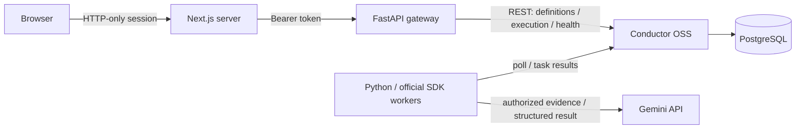

# Orchestra AI

A Python-first AI orchestration workspace powered by **the actual Conductor OSS engine**. Run workflows, inspect their DAG and task attempts, investigate failures, and observe SDK worker polls through a polished Next.js dashboard.


## Start locally

Requirements: Docker Engine/Desktop with Compose v2, approximately 4 GB available memory, and Python 3 for secret generation. Node and Python dependencies are installed inside the images.

```sh
python3 scripts/setup_env.py
docker compose up -d --build --wait --wait-timeout 180
```

Open **http://localhost:3000**. Copy the `CONTROL_PLANE_TOKEN` value from `.env` into the sign-in form. The generated file has private permissions and is ignored by Git. The browser session uses an HTTP-only, same-site cookie; credentials are never compiled into the frontend bundle.

Only the dashboard (`127.0.0.1:3000`) and authenticated gateway (`127.0.0.1:8000`) are exposed on the host. Conductor and PostgreSQL stay on the private Compose network. The engine stores definitions, queues, execution state, and searchable history in PostgreSQL's named volume. `docker compose down` preserves that volume.

Choose **Run workflow → Diagnostic pipeline** to execute a real workflow without any provider credentials. The prefilled evidence is explicitly synthetic. Choose **Fail once** to see a failed attempt followed by a successful retry; **Exhaust retries** produces a genuine failed execution.

## What is implemented

- Overview with counts scoped to the latest 20 executions, registered definitions, and actual recent worker polls.
- Versioned definition explorer with a three-step sequential DAG and full definition JSON.
- Real execution start, status filtering, pagination, live task timeline, input/output inspection, manual retry and termination.
- Official `conductor-python` workers for normalization, deterministic diagnostics, Gemini analysis, and report assembly.
- Structured AI incident reports with evidence, likely cause, recommended actions and confidence. Reports always require human review.
- Explicit unknown/unavailable/configured service states. No fake CPU, cluster, throughput or provider-health metrics.
- Validated and authenticated management API; bounded timeouts and retries; persistent workflow history.
- Container builds, unit/API tests, real-engine smoke/recovery tests, Playwright browser tests, and GitHub Actions.

## Gemini configuration

Set these values in the ignored `.env` file, then recreate the API and workers:

```dotenv
GEMINI_API_KEY=your-google-ai-studio-api-key
GEMINI_MODEL=gemini-2.5-flash
ENABLE_GEMINI=true
```

```sh
docker compose up -d api workers
```

The model is configurable because model availability and account permissions vary. Running `incident_analysis` sends the submitted evidence to Google and can incur API costs. Enable it only when authorized. `scripts/gemini_smoke.py` starts exactly one synthetic incident workflow and is deliberately excluded from normal tests and CI.

**Current verification limit:** one authorized live Gemini test was attempted. The provider returned a `ClientError`; the task failed and the dashboard records that real failure. No successful Gemini output has been verified. The error response was sanitized, so the exact credential/model/quota cause was not retained. Gemini is disabled again in the local environment. The structured-output and error-sanitization paths pass mocked unit tests; those tests are not evidence of live provider success.

## Architecture



Conductor is the sole scheduler. FastAPI registers the two versioned workflow definitions at startup and proxies controlled management operations. Python workers poll and report task results using the official SDK. The Next.js server forwards the session token to FastAPI; it holds no Gemini key. The DAG represents the actual registered sequential definitions, with execution states overlaid from Conductor.

| Workflow | Tasks | External API |
|---|---|---|
| `diagnostic_pipeline` v1 | Normalize → deterministic diagnostics → report | None |
| `incident_analysis` v1 | Normalize → Gemini analysis → report | Google Gemini |

Task retries are capped at two for deterministic workers, with a 3-second delay, a 75-second response timeout and a 90-second task timeout. Workflow timeout is 600 seconds. Gemini has **zero automatic task retries** and one SDK HTTP attempt to avoid silently repeating billable calls. A manual retry is still an explicit operator action. Conductor uses at-least-once delivery; future side-effecting workers must implement idempotency.

The API retries only reads. It does not automatically retry starts or other mutations after an ambiguous response. Before manually resubmitting a timed-out start, inspect execution history to avoid duplicate runs.

## Development and tests

Use Python 3.11 and Node 22.18+:

```sh
python3.11 -m venv .venv
.venv/bin/pip install -r backend/requirements.txt
npm --prefix frontend ci
PYTHONPATH=backend .venv/bin/pytest backend/tests -q
npm --prefix frontend run typecheck
npm --prefix frontend run build
```

With Compose running:

```sh
.venv/bin/python scripts/smoke.py
cd frontend
npx playwright install chromium
npm run test:e2e
cd ..
.venv/bin/python scripts/recovery.py
```

The smoke suite creates real executions and tests success, fail-once recovery, exhaustion, manual retry, termination, and search filtering. Recovery tests deliberately stop/kill **this Compose project's workers**, recover queued/in-flight tasks, and restart Conductor to verify persistent history. Do not run these tests against a shared production stack. They never call Gemini.

Browser tests cover authentication/origin checks, a real retrying execution, task inspection, definition JSON/graph, worker observations, mobile overflow, and page errors. Screenshots are captured from the live stack, not fixture data. Traces are disabled to avoid recording session credentials. Generated reports and `.env` are excluded from Git.

For local UI iteration, stop only the containerized frontend with `docker compose stop web`, then use `npm --prefix frontend run dev`. It proxies to the API on port 8000. Resume the container with `docker compose start web` when finished.

## Operations and deployment

See [deployment preparation](docs/DEPLOYMENT.md), [execution plan](docs/PLAN.md), and [verification progress](docs/PROGRESS.md).

```sh
docker compose ps
docker compose logs --tail 100 api workers
docker compose logs --tail 100 conductor
```

A gateway liveness check is available at `/healthz`. Authenticated `/api/infrastructure` reports engine metadata reachability, recent queue poll observations and Gemini configuration. PostgreSQL is not separately probed by the dashboard; Compose health checks verify database readiness. An observed worker poll is not a guarantee of successful task execution.

The Conductor image is pinned by digest; Python transitive dependencies and npm dependencies are locked. PostgreSQL and application runtime images use explicit versions. CI builds the complete Compose deployment and runs the same deterministic tests. The repository is now published privately at [VarunTx/orchestra-ai](https://github.com/VarunTx/orchestra-ai). GitHub Actions verification has started; see the repository Actions tab for its current result.

## Scope and limitations

This is a working single-workspace MVP, not a hosted multi-tenant platform. A shared admin token provides access to all managed execution input/output. There is no RBAC, SSO, audit-log service, workflow editor, arbitrary workflow import, secret redaction of operator-submitted logs, or automatic remediation. Keep sensitive incident data out of this demonstration deployment.

Only the two managed workflows are exposed. The DAG renderer supports their sequential structure; it is not a general nested/fork graph editor. Overview counters explicitly describe their recent-execution window; server-side history filtering and pagination are available in Executions. No scheduled background provider calls are made.

A successful live Gemini result remains blocked by provider access/configuration. No public deployment has been performed. The complete container stack has been built and tested locally; remote hosting, TLS, backups, access control and operational monitoring require deployment-specific configuration.

## Screenshots


## Official references

Implementation checked against the [Conductor Python SDK](https://conductor-oss.github.io/conductor/documentation/clientsdks/python-sdk.html), [Conductor production/storage configuration](https://conductor-oss.github.io/conductor/devguide/running/deploy.html), [official Docker image](https://hub.docker.com/r/conductoross/conductor), and [Gemini SDK documentation](https://ai.google.dev/gemini-api/docs/get-started).
